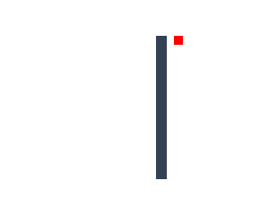

# 고정 축 의존 범례 lane 검증

Source: 98d5e6021f918e80b1a99197b9448c9a52944919.

[구체 계약과 기존 승인](../INFERRED_LEGEND_CLEARANCE.md), [qualification](qualification.json)이 범위와 원 실패를 구분한다.

- 실제 현재 축의 owner progress·stroke·font ink·nested offset·clip에서 native clearance를 계산한다.
- guide@12의 refs-only 상태와 공개 함수 원형을 보존한다. 공유 sampler 변경은 timeline context 한 인자뿐이다.
- 648개 baseline 검증 이후 변경 owner 99개와 overflow 13개를 다시 확인했다. 전체 648개를 최종 source에서 반복했다고 주장하지 않는다.
- 실제 5 datasets × 15 recipes = 75 pairs, 13 browser variants, PNG/PDF, 같은 archive의 Node 20/22/24 각 7 guide cases가 통과했다.
- 최초 설치의 transient canvas overflow와 bundle ceiling 실패를 보존했다. 수정된 최종 archive 38458f6787c03a16515a56b907852addb9d3e93b5c2cdd5050e39af191c7eb0e는 파일 1,231개 모두 현재 packed inputs와 동일하다.
- 동적 axis-label emission/빈 tick group과 종속 제목은 R11 union 후 별도 검증 의무다. 전체 roadmap/release 완료가 아니다.

`guide-middle.json`은 실행된 public frame, SVG/PDF/PNG는 같은 렌더 입력이다. 새 renderer나 endpoint pixel 의미 추측은 없다.
