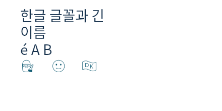

# 공개 font checkpoint 검증

## 진행 상태

- [x] 공개 source `ad538d08d195a2d9aac4e29a130149a4c5227bf0` commit/push
- [x] font resource·schema 2 exact metrics·동기 적용·replacement closure·저장 복원
- [x] 실제 Korean/combining/ZWJ/flag font와 Canvas/SVG/PNG/PDF·scene
- [x] 동일 tar의 Node 20/22/24 source-free 설치·타입·tutorial·bundle
- [x] source coverage·critical floor·실제 action/option 증거·공개 문서
- [x] 초기 실패와 수정 후 증거를 구분하여 보존

승인 근거와 API는 [PUBLIC.md](PUBLIC.md)가 소유한다. 이 기록은 STEP-019의 branch checkpoint를 닫는다.
Main 통합, P2 shadow의 blur/color/offset/clip 소비자, 후속 STEP-033–035 및 전체 STEP-077 완료를 대신하지 않는다.

## 검증 결과

| 범위 | 결과 |
| --- | --- |
| Canonical full coverage | 7,334개 중 7,333 통과. 유일한 일반 검사 실패는 아키텍처 문서의 이전 bundle 상한 2개였다. 원래 종료 코드 1 보존 |
| 문서 기대값 수정 | owning 검사 3/3, 최종 discovery+documentation 19/19 통과 |
| 전체 source coverage | lines 96.39%, branches 94.20%, functions 98.86%; source 파일 누락 없음 |
| Critical floors | 기존 전체 실행의 318개 + 동일 소스에서 renderer 보완 2개 = 320개 통과 |
| Renderer 보완 | `bf2a1f1da`의 `structured-fill-contours.test.js`를 그대로 재사용. 기존 3개 renderer 테스트와 33/33, circle/path functions 각각 100% |
| 설치 패키지 | 같은 tar에서 Node 20.20.2/22.23.1/24.22.1 각각 210 cases + 7 qualification groups + 73 tutorials 통과 |
| 실제 호출 증거 | generated lifecycle 3/3 + corrected feature ledger 7/7. 33,179 ledger entries와 실제 font prepared/token witness |
| 공개 문서 | 169/169, canonical 생성·freshness 통과; built 154 pages/1,305 selective artifacts; desktop 및 320/390/768px 통과 |
| 실제 font 출력 | native Canvas/PNG·PDF의 public/primitive 전체 픽셀 일치, SVG 문자열 일치, Browser Canvas/SVG ink와 embedded face 2개 load 확인 |

Canonical coverage runner는 부분 selector를 허용하지 않는다. 따라서 원 실행을 성공으로 덮어쓰거나
부분 실행을 canonical 전체 재실행으로 표시하지 않았다. 같은 source hash에 대한 독립 증거를 결합하고,
저장된 원 보고서에는 repository `assertSourceCoverage` 및 318개 `assertCriticalCoverage`를 적용했다.
나머지 2개는 실제 contour 회귀의 instrumented 보고서로 원래 floor를 만족하는지 확인했다.
합성 coverage 비율이나 가짜 전체 성공 receipt를 만들지 않았다. 상세는
[coverage-settlement.json](public-evidence/coverage-settlement.json)이다.

전체 direct lifecycle의 50개 profile 검사는 root가 이미 통합 작업에서 실행 중이었다. 중복 runner만
SIGTERM으로 중단해 종료 코드 143을 보존했고 통과에 포함하지 않았다. 수정된 feature ledger는 별도
canonical realistic runner에서 7/7 성공했다. 해당 source/profile 입력이 바뀌지 않은 기존 generated
lifecycle 3/3과 함께 사용한다. 원 raw log와 수정 후 receipt를 모두 보존했다.

## 동일 artifact와 입력 증명

- Tar SHA256: `33a8ed88e9392d05aa2ea2b4ac3349fef1bdb2c2b816f409d375827adfd8575b`
- 803 entries; packed 1,187,379 bytes; unpacked 5,458,545 bytes.
- Node 20/24의 최대 gzip: Full 584,337 / Basic 344,844 / SVG 19,018 bytes.
- 기존 상한: Full 585,000 / Basic 345,000 / SVG 25,000 bytes.
- Source freeze 이후 `src/`, `types/`, package manifest/lock 변경 0.
- 고정 tar의 803개 일반 파일 모두 현재 worktree에 canonical package staging의 JSON/JavaScript 압축만 적용한 값과 일치.

[reuse-proof.json](public-evidence/reuse-proof.json)과 archive entry hash를 보존했다. Metadata·테스트·종료
기록 변경에 설치 전체를 반복하지 않는다. 초기 unit/contracts/docs/render 실패 및 수정 후 결과는
[summary.json](public-evidence/summary.json)에 원인별로 구분한다. 로그는 gzip으로 압축했으며 원문을
변경하지 않았다. 이 tar는 검증용 로컬 artifact이며 npm publication을 수행하지 않았다.

## 재현 경계

```sh
node scripts/run-tests.js coverage
node --test --experimental-test-coverage \
  --test-coverage-include=src/renderers/canvas/circle.js \
  --test-coverage-include=src/renderers/canvas/path.js \
  test/unit/renderers/canvas-renderer.test.js \
  test/unit/renderers/canvas-path-renderer.test.js \
  test/unit/renderers/canvas-stroke-details.test.js \
  test/unit/renderers/structured-fill-contours.test.js
node scripts/run-tests.js realistic contracts/generated-scenario-feature-coverage.test.js
npm run docs:generate
```

설치 실행의 정확한 Node/command 및 7개 group receipt는 `public-evidence/installed-node{20,22,24}/`에 있다.
Source-free tutorial은 공개 `ggaction` import와 명시 supportFiles만 사용한다. 기존 geometric TTF의
literal advance와 실제 Korean/emoji subset의 identity·ink 증거를 구분하며, 모든 Unicode font fallback
또는 backend 간 antialiasing 동일성을 주장하지 않는다.

Native 등록의 동시 수명 보장은 동일 library-owned native adapter의 alias/contentHash lease에 적용된다.
Public host가 직접 반환한 외부 registration은 그 host가 dispose를 소유한다. 다른 external global
registration 변경을 감지하거나 안전하게 해준다는 약속은 없다. Actual glyph helper는 opacity 1에서
fill+outline의 copied RGBA와 alpha를 반환하며, shadow가 사용할 실제 ink frame은 paints owner가
native metrics로 검증한다. Advance rectangle이나 fontSize 비율을 glyph mask로 대체하지 않는다.


