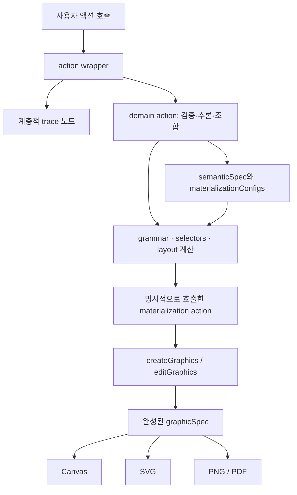

# ggaction 저장소 분석

> **다른 환경에서 이어서 작업:** [인계 안내](TRANSFER.ko.md)를 먼저 읽으세요. 최신 계획은 [77개 실행 카드 로드맵](coverage-expansion-2026-10-27/ROADMAP.ko.md)입니다. 아래 내용은 최초 저장소 조사 당시의 기록입니다.

후속 조사: [README 및 docs 정확성과 사람·agent 사용성 개선 보고서](docs-audit/REPORT.ko.md).

분석 기준일: 2026-10-23 (Europe/Copenhagen)  
클론: `/Users/hj/Desktop/ggaction_chongjeonglee/ggaction`  
기준 커밋: `202b7afd4146a691c136964c4cc53f9c37444513` (`main`, manifest `0.0.22`)

## 1. 이 저장소의 역할

ggaction은 **차트를 작성하고 수정하는 과정을 불변 상태와 계층적 액션으로 표현하는 JavaScript 시각화 라이브러리**다. 사용자는 메서드 체인으로 차트를 만들고, 라이브러리는 결과의 의미, 구체적인 그래픽, 그 결과를 만든 실행 과정을 함께 보존한다.

핵심 연구·설계 문제는 “최종 차트가 무엇인가”와 함께 “사용자가 어떤 결정을 거쳐 차트를 만들었는가”를 표현하는 것이다. 하나의 고수준 작성 액션을 더 작은 의미 있는 액션들로 분해할 수 있어 작성 과정 설명, 편집, 대안 비교, 작성 보조와 추천 시스템의 기반으로 사용할 수 있다. 이 저장소에 완성된 추천 UI나 임의의 차트 명세를 자동 변환하는 제품이 포함된 것은 아니다.

현재는 runtime만 있는 작은 패키지를 넘어, 공개 타입·액션 계약·문서 사이트·실행 예제·독립 수학 oracle·다중 렌더러 검증·실데이터 검증·로컬 MCP·릴리스 파이프라인을 함께 관리한다. 구현 언어는 ESM JavaScript이고 TypeScript 선언을 별도로 제공한다. `package.json`에는 필수 runtime dependency가 없으며 native 출력과 MCP에 필요한 두 패키지는 optional peer dependency다.

현재 사실은 [package.json](../ggaction/package.json), [공개 README](../ggaction/README.md), [현재 아키텍처](../ggaction/agent_docs/SECOND_ARCHITECTURE.md), 실제 소스와 테스트를 교차 확인했다. 초기 설계의 `createCircleMark` 같은 과거 예제를 현재 API로 사용하면 안 된다.

## 2. 조사 범위와 파일 지도

Git 추적 파일은 **4,383개**다. 모든 파일을 읽어 크기·해시·파일 유형을 색인했고, 텍스트 파일은 선언·import·액션 이름·테스트 제목·문서 제목·JSON 구조를 추출했다. 텍스트 4,180개, 바이너리 203개이며 전체 텍스트는 생성물·데이터·과거 기록을 포함해 832,701줄이다. 이는 모든 줄과 모든 바이너리를 사람이 정독하거나 시각적으로 검증했다는 의미가 아니다.

핵심 상태·실행·편집·출력 경로는 소스를 직접 읽고 계약·테스트·실행 probe로 대조했다. 전체 액션은 현재 계약과 생성 카드에서 전수 연결했다. 과거 구현 기록과 개별 이미지·수치 데이터는 전체 색인 및 대표 자료 검토 수준을 구분한다.

| 영역 | 추적 파일 | 역할 |
| --- | ---: | --- |
| `src/` | 601 | JavaScript 실행 코드 595개와 영역별 지침 6개. 소스 전체 89,169줄 |
| `test/` | 1,492 | 단위·계약·차트·브라우저·문서·oracle·실데이터 검증 |
| `agent_docs/` | 1,504 | 현재 아키텍처·계약과 과거 로드맵·승인·검증 기록 |
| `docs/` | 417 | Jekyll 사이트, 개념 설명, API, 튜토리얼, 레시피, 생성 참조와 이미지 |
| `examples/` | 245 | 공개 작성 프로그램·HTML·브라우저 실행 코드·예제 registry |
| `scripts/` | 60 | 테스트·문서/메타데이터 생성·패키지 검사·시나리오·릴리스 도구 |
| `knowledge/` | 14 | 액션 카드·의도 분류·관계·task resolver·MCP 리소스와 schema |
| `types/` | 12 | 모든 공개 entry의 TypeScript 선언 |
| `data/` | 10 | 예제 데이터와 외부 실데이터 corpus 명세 |
| `benchmarks/` | 4 | 고정 LLM 실험 요약과 결정적 작성 요구 평가 |
| `.github/` | 8 | CI·릴리스·Context7 갱신, 이슈/PR 양식, 의존성 자동화 |
| 최상위 파일 | 16 | manifest/lock, README, CHANGELOG, 지침, 라이선스, Ruby/Jekyll 설정 등 |

- [전체 파일 색인](FILE_INDEX.md): 4,383개 파일의 탐색 단서.
- [기계 판독 색인](inventory.json): 해시·행 수·대략적 함수/import/테스트/제목 목록. 정규식 기반 탐색 자료다.
- [293개 액션 지도](ACTION_MAP.md): 목적, entry, 작성 역할, 하위 액션, 편집 주체, 현재 계약 링크.
- [GitHub 확인 기록](github-snapshot.json): 릴리스, 최근 PR, 열린 이슈, Actions 결과.

## 3. ChartProgram의 상태 모델

실제 클래스의 소유자는 [core/ChartProgram.js](../ggaction/src/core/ChartProgram.js)다. [ChartProgram.js](../ggaction/src/ChartProgram.js)는 이 클래스를 상속하고 전체 액션 registrar를 적용한다. Basic도 같은 core를 다른 액션 집합으로 조립한다.

| 상태 | 저장하는 것 | 구분해야 할 것 |
| --- | --- | --- |
| `semanticSpec` | datasets, layers/marks, encodings, scales, coordinates, guides, 제목 텍스트 | 데이터 필드·통계·좌표계·domain 등 차트 의미 |
| `graphicSpec` | `objects`와 root `order`, 명시적 자식 순서, 반복 `items`, 이미 계산된 좌표·paint·텍스트 | 렌더러가 실제로 소비하는 결과 |
| `resolvedScales` | 결정된 domain/range와 mapping에 필요한 값 | 작성한 scale 의도와 계산 결과를 분리 |
| `materializationConfigs` | 마크 외형·가이드 배치·제목/Canvas·selection/highlight·파생 데이터의 재계산 의도 | semantic도 일회성 pixel 결과도 아닌 재생 가능한 설정 |
| `children`, `compositionSpec` | 이름 붙은 불변 child program과 합성/facet 배치 정책 | child 의미를 부모 layers에 평탄하게 합치지 않음 |
| `context` | 현재 선택된 data/mark/scale 등의 추론 보조 | 렌더링의 진실 원천이 아님 |
| `trace`, `actionStack` | 작성 액션과 하위 호출, 실행 중인 trace 경로 | 완료된 public 호출의 stack은 비어 있음 |

`markConfigs`, `guideConfigs`, `titleConfig`는 별도 복제 상태가 아니라 `materializationConfigs`를 가리키는 getter다. `_actionSequence`는 비열거 private bookkeeping이다.

불변성은 `Object.freeze(program)`만으로 이루어지지 않는다. 외부 array/plain object는 재귀 복사 후 freeze하고, 라이브러리가 이미 소유한 불변 값만 `WeakSet`으로 식별해 재사용한다. 변경 경로만 복사하고 나머지는 공유한다. 외부에서 얕게 freeze한 객체를 안전한 소유 값으로 오인하지 않는다. `_clone()`은 `new this.constructor(...)`를 쓰므로 extension subclass도 유지된다. 소유자는 [immutable.js](../ggaction/src/core/immutable.js)와 [programState.js](../ggaction/src/core/programState.js)다.

이전 program들을 유지하면 branching과 되돌리기 UI의 기반이 된다. 자동 undo 관리자가 제공되는 것은 아니며 어떤 checkpoint를 유지할지는 소비 앱의 책임이다.

## 4. 한 액션이 실행되는 원리



[action.js](../ggaction/src/core/action.js)의 wrapper는 option object와 scope를 검사하고 trace에 진입한 새 program을 만든다. implementation을 그 상태에서 실행하고 동일 runtime class의 반환값인지 확인한 뒤 trace stack을 빠져나온다. 내부 wrapped 호출은 현재 액션의 자식으로 들어간다. 예외에는 operation 등의 구조화된 진단이 붙는다.

배열 인자는 trace에서 원본 전체 대신 count로 요약된다. 함수도 함수 자체를 저장하지 않는다. 따라서 **trace는 모든 입력이 들어 있는 replay script가 아니다**. 저장·복원은 별도의 canonical state snapshot을 사용한다. trace append는 persistent child tail과 지연 생성하는 frozen children 배열로 이미 있는 sibling 전체를 매번 복사하는 비용을 줄인다.

대표 흐름인 [createScatterPlot](../ggaction/src/actions/charts/scatter.js)은 입력을 정규화하고 `createPointMark → encodeX → encodeY → 선택적 color/size/shape → createGuides`를 조합한다. 하나의 독립된 scatter renderer를 만드는 방식이 아니다.

[encodePosition](../ggaction/src/actions/encodings/position/index.js)은 대상과 field/scale/coordinate를 해결한 뒤 의미 상태를 기록하고 scale·guide binding을 정리하며 해당 마크의 materialization policy를 실행한다. 실제 point 좌표, 모양, 크기, missing 처리, jitter/packing 등은 [point materializer](../ggaction/src/actions/marks/point/materialize.js)가 조정한다.

핵심은 **semanticSpec을 바꾸었다고 자동으로 그림을 다시 만드는 compiler/observer가 없다는 것**이다. domain action이 필요한 갱신을 책임진다. 직접 probe에서 `editSemantic`으로 x field만 바꾸면 graphicSpec identity와 SVG가 그대로이고, `encodeX`로 바꾸면 그래픽이 달라짐을 확인했다.

다만 “자동 처리가 전혀 없다”는 설명도 부정확하다. 최상위 action 완료 시 theme 같은 범용 외형 정책을 정리하는 completion hook은 있다. 이는 semantic 명세를 통째로 compile하는 단계와 구분된다.

## 5. 코드 계층과 변경의 책임

| 경로 | 책임 | 대표 진입점 |
| --- | --- | --- |
| `src/actions/` | 공개/내부 액션, lifecycle, inference, atomic orchestration | `index.js`, `charts/`, `data/`, `encodings/`, `guides/`, `marks/` |
| `src/core/` | 불변 상태, action/trace, 공통 검증·ID·어휘·진단 | `ChartProgram.js`, `action.js`, `immutable.js`, `validation.js` |
| `src/grammar/` | scale·좌표·통계·transform·경로·schema의 순수 계산 | `transforms.js`, `datasetDependencies.js`, `scales/`, `regression/` |
| `src/selectors/` | 이름이 있는 resource의 조회와 추론에 필요한 조회 기반 | `datasets.js`, `layers.js`, `scales.js`, `axes.js` |
| `src/layout/` | Canvas/plot bounds, title·legend·facet·text·충돌 계산 | `canvas.js`, `facets.js`, `labels.js`, `guideCollisions.js` |
| `src/materialization/` | 의미를 실제 그래픽으로 실현하는 공통 정책·dependency 계획 | `planner.js`, `dependencies.js`, `marks/`, `selection/` |
| `src/renderers/` | concrete graphic tree를 backend에 출력 | `canvas/`, `svgSerialization.js`, `png.js`, `pdf.js` |

lexical import 분석으로 소스 내 참조 3,282개를 찾았다. 많이 공유되는 모듈은 validation, immutable, action, layer/dataset selector다. 이 수치는 정규식 기반 탐색 결과이며 정확한 구조 규칙은 [source-boundaries.test.js](../ggaction/test/contracts/source-boundaries.test.js)가 import parser로 검사한다. 해당 테스트는 허용된 계층 의존, 순환 참조 부재, primitive 상태 변경 경계 등을 강제한다.

현재 direct action catalog는 **293개**이며 분류는 user-facing 286, advanced 4, primitive 3이다. `hconcat/vconcat` 같은 package-level factory와 internal wrapped action 목록은 별도로 구분해야 한다. Catalog의 `Mutable resource`는 같은 resource ID를 편집할 수 있다는 lifecycle 분류이지 JavaScript 객체의 in-place mutation을 뜻하지 않는다.

domain별 수는 core 47, statistics 45, marks 33, encodings 39, axes 55, grid 11, legend/title 13, selection 7, composition 12, charts 28, primitives 3이다. 실제 완성형 chart family는 여러 domain에 분산되어 있어 `charts: 28`을 차트 지원 수 전체로 해석하면 안 된다.

H0–H4는 작성 역할과 분해 관계를 표현하는 metadata다. 한 action이 여러 역할을 가질 수 있고 모든 trace에서 고정된 깊이를 갖는 것은 아니다. 세부 관계는 [ACTION_MAP](ACTION_MAP.md)에 연결했다.

## 6. 데이터, 통계, 편집, 선택, 합성

**데이터와 transform.** 원본 rows는 불변 dataset에 보존된다. typed schema는 storage type, nullable, optional, 원본/추론/파생 여부와 field lineage를 기록한다. 시각화의 quantitative/nominal/temporal 의미와 raw storage type은 구별된다. computed, filter, fold/flatten, lookup, summary, bin/bin2d, stack, window, timeUnit, regression, density, interval, ECDF 등은 명시적 파생 dataset을 만든다.

원본이나 transform을 수정할 때 기존 dataset의 values를 덮지 않는다. logical owner가 현재 physical revision을 가리키고 dataset reference graph를 따라 새 revision과 소비자의 rebind를 계획한다. lookup은 두 dataset 입력을 가지므로 [datasetDependencies.js](../ggaction/src/grammar/datasetDependencies.js)는 안정적인 위상 순서를 사용한다. 기존 독립 분기·원본 rows·field lineage가 유지되는지가 중요하다.

**통계.** [regression](../ggaction/src/grammar/regression/models.js)은 linear/polynomial/LOESS 등을 순수 계산하고, 입력값 규모가 극단적인 경우를 위한 수치 안정화도 포함한다. 고수준 `createRegression`은 source point의 data, x/y, grouping, scales를 해석하고 파생 데이터·band·line을 하위 액션으로 만든다. summary/interval의 bootstrap은 seed와 sample 수를 명시하고, 같은 관련 interval은 sample stream을 공유한다. raw row를 가짜 통계 행으로 바꾸는 방식과 구분된다.

**재계산.** [planner.js](../ggaction/src/materialization/planner.js)는 `scales → marks → guides → layout → highlights` 순서로 작업을 정리하고 같은 op/args를 중복 제거한다. 모든 편집이 무조건 전체 차트를 다시 계산하는 것은 아니며 영향을 받는 consumer를 해당 정책에서 수집한다. 일부 복잡한 편집은 불변 후보 분기에서 완전한 계산을 먼저 수행해 검증한 다음 실제 반환 분기를 만든다. 예를 들어 `reviseData`에는 명시적인 preflight 적용과 반환 적용이 있다. 이 비용은 제품 성능 측정에서 의미가 있다.

**선택과 highlight.** 선택 대상은 항상 raw row index가 아니다. point의 관측치, 집계 bar의 cell/group, line/area의 series, rect cell, arc sector처럼 최종 시각 항목의 grain을 사용한다. field, semantic channel, graphic property도 다른 입력이다. 마크별 adapter가 items와 안정적인 key를 해결하고 공통 selector가 조건/range/rank를 적용한다. highlight는 재계산 때 clean baseline 위에 다시 적용되어 이전 opacity·offset 등이 누적되지 않게 한다.

**합성/facet.** `hconcat/vconcat`은 완성된 child program을 이름과 함께 보존하고 concrete graphic ID를 namespace한다. `facet/facetGrid/repeatCharts`는 원본 template와 transform ancestry에서 child를 만들고, shared/independent domain을 결정한 뒤 child-local coordinate range로 다시 materialize한다. shared scale은 모든 child에 부모 pixel range를 씌운다는 뜻이 아니다. 부모는 child snapshot, outer axes/shared legend, header, title을 배치한다.

**가이드/텍스트.** axes·grid·legend·title은 생성/부분 편집/삭제와 scale/data/Canvas 변화 후 재생을 갖는다. text wrapping과 위치는 렌더러 이전에 계산한다. 기본 text width는 결정적인 추정 정책이며, 측정된 text metrics profile을 추가할 수 있다. 정적 bounds와 실제 폰트 ink/pixel visibility를 동일시하면 안 된다.

## 7. 공개 entry와 출력 경계

| import | 역할 |
| --- | --- |
| `ggaction` | 전체 chart factory, concat factory, Canvas render |
| `ggaction/basic` | scatter/line/bar/histogram/heatmap의 작은 생성 중심 surface |
| `ggaction/extension` | ChartProgram, action(), extension 등록, primitive 작성 기반 |
| `ggaction/svg` | DOM 없이 SVG 문자열 생성 |
| `ggaction/png`, `ggaction/pdf` | Node native 출력; file 및 buffer API |
| `ggaction/persistence` | editable program과 graphic-only snapshot 저장/복원 |
| `ggaction/inspection` | schema, 액션 기술, revision 비교, 마크·가이드 검사 |
| `ggaction/accessibility` | 지원되는 의미/최종 grain의 accessible data export |
| `ggaction/diagnostics` | 예외에 연결된 구조화된 진단 정보 |
| `ggaction/scene` | SVG/Canvas transition scene과 Canvas scene 출력 |

렌더러는 field/scale/통계 의미를 다시 계산하지 않고 `graphicSpec`을 읽는다. 구체 primitive는 canvas/circle/rect/line/text/path 및 collection 구조를 사용하고 sibling 순서가 painter order다. path는 `M/L/C/Z` 명령으로 materialize된다. 곡선 보간에는 linear, step 계열, basis, cardinal, monotone, natural이 있으며 모양은 renderer 이전에 결정된다.

PNG는 native Canvas를 사용하고 PDF는 같은 concrete drawing을 vector context로 출력한다. `pixelRatio`는 logical layout과 독립된 physical raster 밀도다. Node-only dependency를 browser entry에서 가져오지 않는지 package/consumer test가 검사한다.

Editable snapshot의 현재 schema는 v3이며 이전 v1/v2를 읽는 migration 경로가 있다. tag 기반 codec과 shared-array 표현을 사용하고, 단순 `JSON.stringify(program)`을 공식 저장 형식으로 간주하지 않는다. 복원 시 references, trace, schema, graphic tree 등을 검증한다. Graphic-only snapshot은 v1이고 편집용 의미 상태 없이 출력에 사용할 수 있다.

Transition scene은 immutable program에서 안정적 key, topology, offset, clip, graphic payload를 추출하고 program identity별로 cache한다. SVG scene v1, Canvas scene v2가 있다. 이 entry 자체가 시간축·UI 이벤트·animation scheduler를 운영하는 것은 아니다.

## 8. Inspection과 MCP의 실제 보장 범위

`describeAction()`은 descriptor와 일부 상태/옵션 검사를 수행한다. **`supported`는 실제 실행·렌더 성공 보장이 아니다.** 이번 probe에서는 `opacity: 2`에 static `supported`, execution `not_run`이 나왔지만 실제 action은 0–1 범위를 위반했다고 거절했다. 기존 program과 trace는 변하지 않았다. 추천 UI는 이 반환값만으로 Apply 성공을 확정하면 안 된다.

`comparePrograms()`는 data/binding/structure/scale/guide/style 변화를 비교하고 trace-only ID와 context/cache identity를 의미 변화로 취급하지 않는다. 확장 소유 의미는 unknown일 수 있다. `inspectProgram()`도 raw rows, logical items, drawable primitives, visible candidates를 구분하며 occlusion이나 실제 pixel visibility는 측정하지 않는다.

로컬 MCP는 [server.js](../ggaction/src/mcp/server.js)의 stdio 서버와 [task-resolver.js](../ggaction/knowledge/task-resolver.js)로 구성된다. bundled knowledge를 읽어 `search_ggaction({query})`에 bounded task packet, imports, prerequisite, 순서 있는 불변 호출, placeholder와 미해결 요구를 반환한다. 차트 코드를 실행하거나 모델 API를 호출하는 서버가 아니다. 임의 파일 접근 기능도 제공하지 않는다.

이번에 발견한 재현 가능한 제한:

```text
입력: Create a scatter plot of x versus y colored by group
제안: createScatterPlot({ x: "versus", y: "colored", color: "ed" })
상태: unmatchedRequirements + request.unconsumed 경고가 함께 존재

입력: Create a scatter plot with x: x, y: y, color by group
제안: createScatterPlot({ x: "x", y: "y", color: "group" })
상태: 이 예제에서는 unresolved/unmatched가 비어 있음
```

소스의 정규식 field extraction과 stop-word 경계를 읽어 원인을 확인했다. 자연어 문장 전체를 이해하는 모델과 같은 보장을 기대하면 안 된다. 경고를 없앤 성공으로 보고하지 않았고, 이번 요청은 조사이므로 라이브러리 수정이나 GitHub 이슈 작성은 하지 않았다. 재현 입력과 결과는 [probe 결과](probe-output/results.json)에 남아 있다.

`benchmarks/llm-authoring-v1`은 24 tasks × 2 repetitions × 3 models × 4 conditions = 576 runs의 과거 고정 실험이다. 전체 최신 액션이나 임의 자연어의 보편적 성능으로 확장할 수 없다. 별도의 현재 결정적 `benchmark:authoring`은 15개 회귀 사례를 다루며 실제 실행 결과는 pass 15, executable 15, fulfilled 10, falseComplete 0이다. 일부 요구를 명시적으로 미해결 처리하는 사례도 성공 조건에 포함되어 있어 “15/15 완전한 차트 요구 충족”이라고 쓰면 틀린다.

## 9. 문서와 개발 증거가 연결되는 방식

현재 exact contract는 [ACTION_INDEX.json](../ggaction/agent_docs/contract/ACTION_INDEX.json)과 `contract/current/`의 16개 domain 문서가 소유한다. `SECOND_ARCHITECTURE`는 macro architecture, `INITIAL_ARCHITECTURE`와 `impl/roadmap*`는 과거 설계/진행 증거다. 현재 index의 planned actions/capabilities는 0이지만 GitHub의 미구현 제안이 없다는 뜻은 아니다.

`types/program.d.ts` 등의 선언, action card source, contract와 example registry를 기반으로 signatures, references, hierarchy, chart picker, inspection descriptors, search, machine artifacts, LLM 문서를 생성한다. `docs/doc-provenance.json`은 package version만 보지 않고 runtime contract fingerprint와 source reference를 함께 기록한다. 문서 빌드는 pinned Jekyll/Ruby를 사용한다.

최상위 기타 파일도 각각 역할이 있다. `package-lock.json`은 JS dependency 재현, `Gemfile.lock`은 문서 build dependency 재현, `.ruby-version`은 권장 Ruby, `context7.json`/`llms.txt`는 외부 문서 발견, `.gitignore`는 node_modules·_site·실행 artifacts 제외, CONTRIBUTING/SECURITY/CODE_OF_CONDUCT/LICENSE는 기여·보안 신고·행동 규범·MIT 라이선스를 설명한다.

관찰한 문서 정합성 주의점: `docs/compatibility.md`의 “Chromium 이외 브라우저는 자동 호환성 주장에 포함되지 않는다”는 문장은 현 CI/release의 Firefox·WebKit job과 일치하지 않는다. 이번 릴리스의 두 job은 실제 success였다. 또한 architecture 문서에는 여러 시점의 package budget 기록이 섞여 있으므로 현재 크기는 실제 package 측정과 manifest를 기준으로 판단해야 한다.

## 10. 테스트 구조와 이번 검증

일반 `npm test`는 unit/contracts/charts/gates/docs를 실행한다. `.render.js`·`.browser.js`·외부 corpus가 필요한 realistic 테스트는 의도적으로 분리되어 있다. “npm test 성공”을 모든 CI job의 성공으로 확대해서는 안 된다.

- Unit: pure 계산, inference, lifecycle, immutable state, error/edge case.
- Contracts: 소스 계층·export·타입·현재 계약·생성 metadata·테스트 발견·옵션/entry 일치.
- Chart slices: 공개 프로그램, 별도로 작성한 primitive 기준 프로그램, numeric reference, variants, 렌더 결과.
- Oracles: production source를 import하지 않는 독립 수학 구현과 literal 기준값.
- Browser: Canvas/SVG 실제 동작, 예제 readiness, console/page error, native output과의 일치.
- Render: 같은 플랫폼의 공개/primitive pixel 비교, ink bounds·density, PNG/PDF/SVG 관련 별도 검사와 갤러리.
- Docs: source 예제 실행, built links/assets/ID, search·keyboard·accessibility·responsive/no-JS.
- Realistic: 50개 TidyTuesday 원본의 hash/rows/schema/provenance, action/option/literal 사용과 실제 차트 효과.

CI source coverage의 global floor는 lines 94%, branches 89%, functions 98%이며 위험 경계별 추가 floor가 있다. 이것은 목표치이고 이번 로컬 측정 coverage 값은 아니다.

실데이터 원본은 Git에 모두 담겨 있지 않다. `data/corpus/manifest.json`이 고정 source와 checksum을 소유하며 `datasets:sync`가 `.artifacts`에 내려받는다. 별도 3,600-scenario 러너는 50 datasets × 72 scenarios, 격리 child process·메모리/시간 예산·replay·artifact ledger를 갖는다. 이 러너와 CI realistic shard suite도 구분해야 한다.

이번 로컬 결과는 [검증 기록](VERIFICATION.md)에 정리했다. normal 5,499, browser 163, render 261이 모두 통과했고 built docs 150페이지, installed package 및 package boundary도 확인했다. 검증 runtime은 Node v23.5.0/npm 11.18.0이며 CI의 Node 20/22/24 matrix와 동일 환경은 아니다. 문서는 설치되어 있던 Ruby 3.2.6을 `mise exec`로 활성화했다. 시스템 기본 Ruby 2.6.10을 사용한 것으로 기록하지 않는다.

이번 로컬에서는 전체 coverage 계측과 50-source realistic shard/3,600-scenario 생성을 다시 수행하지 않았다. 대신 동일 release commit의 GitHub release job을 읽어 coverage, 7 realistic shards, macOS/Windows, Firefox/WebKit, source/docs/package, publish와 Pages 배포 성공을 확인했다. 이는 원격 CI 증거이며 로컬 재실행 결과와 분리한다.

## 11. GitHub의 현재 상태

- [PR #263](https://github.com/ggaction/ggaction/pull/263)은 merge되었고 현재 clone/main은 그 merge commit이다.
- [v0.0.22 release](https://github.com/ggaction/ggaction/releases/tag/v0.0.22)는 공개되어 있다.
- [Release run](https://github.com/ggaction/ggaction/actions/runs/39881207750)의 22 jobs는 전부 success다.
- [통합 PR 최종 CI](https://github.com/ggaction/ggaction/actions/runs/39879409933)는 success다. merge commit의 별도 push CI는 cancelled이므로 그것을 green으로 표기하지 않는다.
- 조회 시 열린 PR은 0개, 열린 issue 검색 결과는 아래 4개였다.

| Issue | 아직 남은 기능 |
| --- | --- |
| [#238](https://github.com/ggaction/ggaction/issues/238) | 고수준 regression line의 opt-in plot-last 배치 |
| [#244](https://github.com/ggaction/ggaction/issues/244) | 기존 monotone과 구분되는 명시적 Steffen 보간 recipe |
| [#253](https://github.com/ggaction/ggaction/issues/253) | timeUnit의 row-preserving null calendar bucket 정책 |
| [#258](https://github.com/ggaction/ggaction/issues/258) | full child bounds의 독립 packed facet flow와 shared footer axes |

최근 0.0.18–0.0.22 PR들은 chart-authoring 기능 확장, guide/layout, 원본 보존 transform, 통계 precision, native clip/scene 및 문서·실데이터 검증을 통합한 흐름이다. 과거 로컬 실험이나 이 저장소 외부 corpus의 성공 수를 현재 라이브러리 보장으로 옮겨 적지 않았다.

## 12. 이후 작업에서 사용할 탐색 기준

1. 공개 동작은 `ACTION_INDEX → current contract → types → 가까운 source family → executable test`로 찾는다.
2. 이상한 그림은 먼저 semantic 입력, resolved scale, materialized geometry, painter order/clip, 실제 backend를 순서대로 구분한다.
3. 편집 후 그림이 오래된 상태라면 해당 action의 dependency/rematerialization 계획을 확인한다.
4. facet 문제는 source transform topology, shared domain, child-local range, parent guide/header ownership을 따로 본다.
5. 추천·autocomplete 소비자는 static descriptor, 실제 후보 action 실행, semantic comparison, scene/render evidence를 구별한다.
6. 새 API나 상태 경계를 바꾸는 작업은 root/scoped AGENTS와 현재 계약을 적용한다. 조사 요청 자체는 implementation·commit/push·PR·publish를 승인하지 않는다.

이번 조사 자료는 clone 밖의 `study/`에 저장했다. 저장소 추적 소스는 변경하지 않았다. [실행 probe](probe.mjs), [trace](probe-output/base-trace.txt), [원본/편집 합성 이미지](probe-output/composition.png), [상세 결과](probe-output/results.json)를 통해 핵심 설명을 다시 확인할 수 있다.
