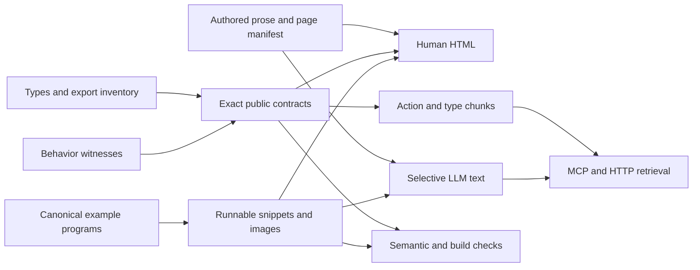

# ggaction 문서 체계 개선안과 완료 기준

[종합 보고서](REPORT.ko.md) · [상세 점검 결과](FINDINGS.ko.md) · [편집 원본 지도](AUTHORING_MAP.ko.md)

이 문서는 제안이다. 아직 README, docs, schema, MCP 또는 사이트 구조에 적용하지 않았다. 목표는 사람·agent·contributor가 같은 현재 계약을 각자의 작업에 맞게 읽고 수정하도록 만드는 것이다.

## 1. 유지할 기반과 바꿀 경계

Jekyll 사이트, current contracts, TypeScript, action catalog, canonical examples, image provenance, existing page manifest, Context7와 MCP를 유지한다. 새 지식 저장소나 별도의 수기 navigation tree를 만드는 대신 기존 원본의 책임과 연결을 명확하게 한다.

| 정보 | 권위 있는 원본 | 사람에게 제공 | Agent에게 제공 | 검증 |
| --- | --- | --- | --- | --- |
| 공개 이름·signature·option 선택성 | exported types와 action inventory | exact reference, common-call 요약 | action/type chunk, package entry index | export coverage, compilation |
| 기본값·inference·조건부 사전조건·실패 조건 | current behavior contract와 실행 witness | API 설명·조건 표·복구 예제 | 조건이 명시된 metadata | 실제 성공/실패/빈 결과와 대조 |
| 과제 설명 | authored tutorial/recipe Markdown | workflow, rationale, 예상 결과 | 같은 원문의 선택적 plain text | 리뷰, source link, 실행 예제 연결 |
| 실행 프로그램 | canonical example와 block-level snippet registry | 코드·결과 이미지·실행 방법 | 원문 코드·fixture·expected observable | source 및 installed consumer 실행 |
| 탐색 | 기존 page/chart manifests | navigation, search, gallery | LLM routing, chunk manifest, MCP resource links | route·anchor·대표 action 의미 검증 |
| 현재 구현 구조 | current architecture와 scoped instructions | contributor task map | 관련 source/contract/test로 가는 task map | package/source ownership 대응 |
| 과거 결정·측정 | 날짜·commit이 있는 history | 필요할 때 링크 | 명시적으로 요청될 때만 회수 | current truth와 구분 |

타입만으로 default나 numeric policy를 추론할 수 없으므로 모든 설명을 자동 생성하자는 제안은 아니다. 자동 생성할 필드와 사람이 설명할 판단·맥락을 분리하고, 후자도 실행 가능한 사례와 연결한다.

## 2. 사람에게 보이는 구조

### README

README는 짧은 진입점으로 둔다. 다음 순서를 권한다.

1. 라이브러리의 목적 한 문단과 대표 결과.
2. 설치 환경·한 개의 완결된 실행 경로. HTML과 module/bundler 전제를 분명히 한다.
3. 불변 program에서 편집 대안을 만드는 작은 예제.
4. 지원 차트·출력·Basic/Full 선택의 짧은 지도.
5. Docs·agent/MCP·extension으로 가는 바로가기.
6. 현재 상태·변경 이력·기여 안내.

상세 MCP 평가와 release maintenance 절차는 해당 owner 문서로 연결한다. MCP를 주요 차별점으로 유지하려면 상단 바로가기를 두되 첫 chart 실행을 중단시키지 않게 한다. 현재의 연구적 설명과 trace 예시는 보존할 가치가 있다.

### 사이트의 목적별 진입점

| 경로 | 독자가 답을 얻는 질문 | 핵심 내용 |
| --- | --- | --- |
| 시작 | 어떻게 설치하고 첫 결과를 보나 | 환경 선택, 완결 프로젝트, 실행 확인 |
| 배우기 | 왜 이 순서로 작성하나 | tutorial, before/after, 최소 core concepts |
| 과제 해결 | 이 차트에서 무엇을 바꾸나 | edit/data refresh/scale/label/facet/output recipe |
| 정확한 참조 | 이 함수의 조건과 결과는 무엇인가 | canonical signature, options, defaults, errors, related types |
| 앱에 통합 | 업데이트·반응형·접근성·저장·출력 오류를 어떻게 다루나 | host 책임과 library 책임, 완결 integration examples |
| Agent와 extension | 어떤 문서를 얼마만큼 읽고 생성·검증하나 | MCP/plain-text, version identity, extension guide |
| 기여 | 어느 원본을 고치고 무엇을 검사하나 | source ownership map, narrow check, full checkpoint |

이는 제안하는 역할 분담이며 모든 URL을 즉시 바꾸라는 뜻은 아니다. 기존 링크와 anchor를 보존하면서 routing overview와 각 페이지의 순서를 먼저 정리한다. 이동이 필요한 경우 redirect와 generated LLM manifest를 함께 갱신한다.

### 페이지 템플릿

**Tutorial:** 완료할 작업과 결과 → 실행 환경/입력 → 순서대로 추가·변경하는 단계 → 왜 그 순서인지 → 최종 프로그램 → 변형과 실패 복구 → 관련 참조.

**Recipe:** 한 과제 → 어떤 기존 program/데이터가 필요한지 → 최소 실행 코드 → 예상 결과/유지되는 것 → 제약 → 정확한 API. 서로 다른 입력 grain을 쓰는 대안은 변수와 prerequisites를 분리한다.

**API:** 목적과 계층 → common call → exact signature → 필수/선택 옵션 → 조건부 default/inference → 입력·출력 grain → 유효한 작은 예제 → 예상 오류와 복구 → 관련 action/type. 모든 action이 모든 칸에 긴 설명을 요구하는 것은 아니다.

**Integration guide:** 실제 state와 environment를 만든 완결 왕복 예제 → expected inspection/output → action failure와 renderer/environment failure → host가 보존·교체할 상태. inspection/scene는 이 패턴이 특히 유용하다.

## 3. Agent가 읽고 생성하는 구조

### 최소 bootstrap

시작 자료에는 실제 설치 버전과 contract identity, import entry 선택, immutable reassignment, Canvas/data/mark 기본 순서, ambiguity와 필수 ID, render boundary만 둔다. 상세 API·역사·모든 옵션을 한 번에 로드하지 않는다. 정확한 함수명과 conditional requirement는 해당 action/type로 이동한다.

### 두 가지 retrieval 경로

**MCP 사용 가능:** request → 작은 task packet → 필요한 action resource → unresolved 항목의 문서 → 코드 실행 → structured error 또는 결과 검증. 기존 read-only/비실행 의미를 유지한다. 긴 입력 및 packet 생성 뒤 runtime failure의 복구 절차를 추가한다.

**MCP 사용 불가:** 작은 index → page/action/type chunk → 연결된 fixture/example → 실행·검증. 제안 URL은 `/llm/pages/<slug>.md`, `/llm/actions/<name>.json`처럼 예측 가능하게 둘 수 있지만, 정확한 URL 설계는 구현 전 선택할 사항이다. 각 chunk는 기존 원본에서 생성하며 full bundle은 offline/archive 경로로 남긴다.

Chunk manifest에는 canonical URL, source, version/contractId, hash, related chunks와 type dependency를 제공한다. 타입 closure를 완성하고 하나의 action을 알기 위해 전체 1.9MB bundle이나 901KB collection을 받아야 하는 상황을 피한다. 이 크기를 고정 token 수로 환산하지 않는다.

### 의미를 가진 기계 계약

현재 카드 schema를 다음 기준으로 검토한다. 아래 필드 이름은 설계 예시이며 즉시 확정한 API가 아니다.

- 무조건적 prerequisite와 특정 option branch에서만 필요한 prerequisite를 구분한다.
- empty input, empty output, incomplete geometry를 별도 의미로 정의한다.
- inference는 단일 resource·current resource·필수 selector 중 어느 규칙인지 나타낸다.
- static support, actual execution, rendered output validation을 구분한다.
- diagnostics는 알려진 error code와 복구 owner로 연결한다. curated errors가 빈 배열이면 “오류 없음”이 아니라 별도 canonical policy를 읽도록 한다.
- packageVersion과 contract identity의 역할을 구분하고 동일 artifact set을 결속한다.

스키마만 검증하면 잘못된 heuristic도 유효한 JSON으로 남는다. title-only chart, constant encoding, empty filter, optional option 생략, 잘못된 값, 불완전 mark를 실행 witness로 삼아 metadata의 뜻을 검증해야 한다.

### 저장소를 수정하는 agent

차트 작성 agent와 라이브러리 수정 agent의 지도를 구분한다. 구현 agent는 root/scoped AGENTS → 현재 architecture 요약 → 해당 contract/source/test로 이동하게 한다. 완료된 1,000여 개 roadmap 파일을 기본 context에 섞지 않는다. 역사 자료는 결정 근거가 필요한 경우에 링크로 찾는다.

설치된 extension guide는 public extension page와 LLM index에서 발견할 수 있게 한다. 그 파일이 모든 소비자 agent에게 자동 적용된다고 주장하지 않고, 명시적으로 읽을 위치와 적용 범위를 설명한다.

## 4. 사람이든 agent든 쓰기 쉬운 문서 작업 흐름

현재 [원본 지도](AUTHORING_MAP.ko.md)를 docs/README의 contributor entry로 옮기는 것을 권한다. 생성물마다 source와 generator가 눈에 띄어야 하며, 사이트의 Edit/Source 링크도 정확한 owner로 가야 한다.

1. 변경하려는 사실·예제·routing의 owner를 찾는다.
2. 해당 원본과 실행 witness를 함께 수정한다.
3. 소유 generator만 실행하고 예상된 생성 diff를 검토한다.
4. 좁은 semantic/freshness 검사를 수행한다.
5. 전체 documentation checkpoint에서 source suite, build, built-link, browser 검사를 수행한다.

현재 `docs:verify`는 생성부터 시작한다. 읽기 전용 검사와 갱신을 더 명확히 구분하는 `docs:check` 성격의 명령을 추가할 수 있다. 기존 CI에는 생성 전 freshness 검사 단계가 있으므로 이를 없다고 보고 새로 만드는 일은 피한다. generator의 check/write 인터페이스를 통일하고, llms.txt의 curated prefix는 별도 source로 분리한다.

## 5. 단계별 실행 계획

| 단계 | 범위 | 선행 조건 | 완료 기준 |
| --- | --- | --- | --- |
| 1. 확인된 내용 수정 | F01–F12의 실행 오류·조건·모순, F20의 잘못된 목적지 | 현재 재현 자료 | 수정 원문을 실행하고 관련 설명/LLM 출력도 일치 |
| 2. 공개 계약 완결 | F13–F19: type closure, runtime reference, 카드 의미, architecture, 입력 제한 | 각 필드의 의미·owner 결정 | public exports 전체 route, docs-only 타입 compile, branch별 semantic witness |
| 3. 예제 검증 단위 확장 | F21: block ID와 setup/fixture/expected observable | 기존 registry 재사용 설계 | 모든 public JS block 분류, 실행 가능한 block 수행, 뒤쪽 예제의 의도적 오류 검출 |
| 4. 탐색과 진입 경로 | F22/F23, D01–D03/D08 | 내용 정확성 확보 | task-query regression, desktop/mobile interaction, 첫 실행·편집 과제 검증 |
| 5. 선택적 agent 자료 | D04–D07과 entry identity | type/card 의미 확정 | full bundle 없이 action+type 회수, MCP/non-MCP 각각 end-to-end 작성·복구 |
| 6. 기여 흐름 정착 | F24와 편집 원본 지도, source/edit links | page/generator ownership 정리 | 네 대표 수정 작업에서 잘못된 생성물 편집 없이 재현 가능 |

단계 1의 오류 수정과 단계 3의 해당 블록 회귀 검사는 같은 checkpoint에 묶는 것이 좋다. 전체 snippet 체계 확장을 기다리느라 명백한 오류 수정을 미룰 필요는 없다. 단계 2의 카드 schema 변경과 단계 5의 artifact identity 변경은 공개 소비자에 영향을 줄 수 있으므로 migration 범위를 구체화해야 한다.

작업일 수는 팀 규모·검토 방식·원하는 URL 호환 범위에 따라 달라지므로 근거 없는 일정 추정은 넣지 않았다. 각 단계는 독립적으로 검토할 수 있는 변경 묶음으로 나눈다.

## 6. 개선이 끝났다고 판단할 기준

### 정확성

- 공개 JS 코드 블록 전체에 실행 방식 또는 구체적인 비실행 이유가 있다.
- complete와 continuation 예제는 원문을 복사해 실제 환경에서 실행할 수 있다.
- 필요한 field와 resource, 반환값, 중요한 결과 grain 또는 출력값을 검사한다.
- exact surface의 entry coverage와 public declaration dependency closure가 완전하다.
- generated metadata의 조건·empty 정책을 실제 동작 사례와 대조한다.
- CI가 중간 예제의 Canvas 누락·잘못된 field·default 설명 변경을 놓치지 않는지 의도적인 오류 주입으로 확인한다.

### 사람의 읽기

첫 chart, 색상 변경, axis label 편집, data refresh, facet 수정, SVG 저장, 오류 복구를 대표 과제로 둔다. task completion, 첫 올바른 결과까지 시간, 잘못 이동한 페이지, 오류 원인을 기록한다. 현재 측정하지 않은 성공률이나 소요 시간을 baseline인 것처럼 적지 않는다. 설치를 마친 사람이 과제에 필요한 페이지·코드·예상 결과를 찾을 수 있는지를 관찰한다.

### Agent의 읽기와 생성

동일 과제를 MCP와 plain-text 경로로 평가한다. 설치 버전 일치, 필요한 자료만 읽은 바이트/토큰, 불필요한 API 생성, unresolved 요구 보존, 실제 실행과 결과 검증, 실패 뒤 복구를 별도로 측정한다. “코드가 parse된다”와 “사용자의 과제를 충족한다”를 분리한다. 기존 15-case authoring benchmark와 고정 LLM 평가를 재사용하되 새 문서 문제 사례를 포함한다.

### 문서 쓰기

문장 수정, 새 옵션 설명, runnable example 수정, agent prerequisite 수정의 네 작업을 contributor와 구현 agent가 수행하도록 한다. 올바른 source를 찾는지, 생성 diff가 예상 범위인지, 최소 검사와 전체 검사가 명확한지 확인한다. 단순히 더 많은 규칙을 AGENTS에 추가하는 것으로 완료하지 않는다.

## 7. 피해야 할 해결 방식

- 문서 전체를 LLM으로 다시 써서 현재의 정확한 계약과 근거를 잃는 방식.
- 모든 snippet을 fragment로 분류하여 실행 책임을 독자에게 넘기는 방식.
- 코드와 모순되는 설명을 검색·chunking만 개선해 더 잘 노출하는 방식.
- 공개 entry·navigation·default를 여러 수기 표로 다시 복제하는 방식.
- 과거 버전 문자열을 일괄 치환해 migration baseline과 실험 provenance를 손상하는 방식.
- generated output을 직접 고쳐 다음 generation에서 되돌아가게 하는 방식.

현재 기반을 보존하면서 **내용의 진실성, 예제의 문맥, 탐색의 목적성, 편집의 책임**을 연결하는 것이 이 개선안의 범위다.
